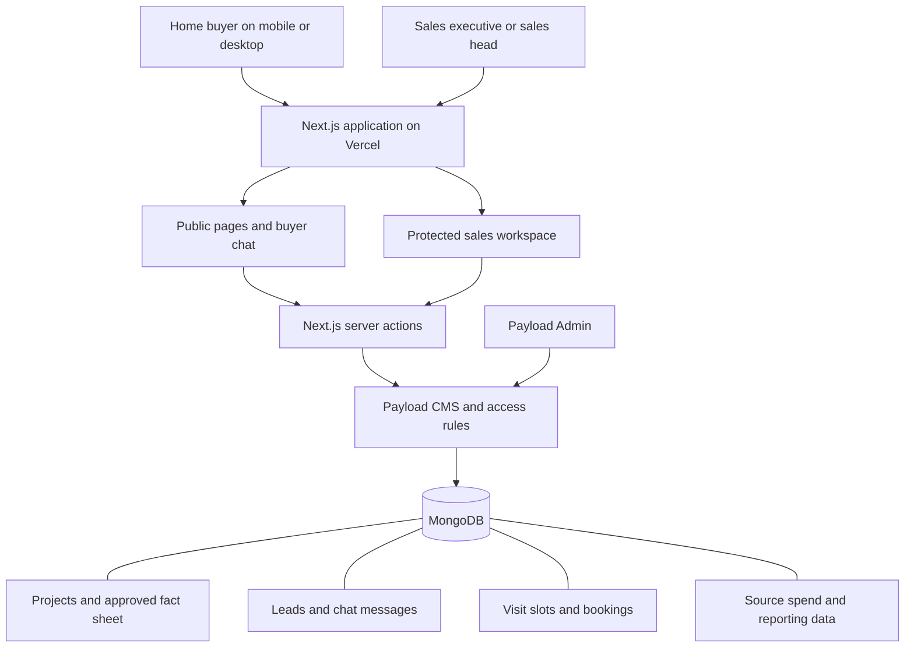
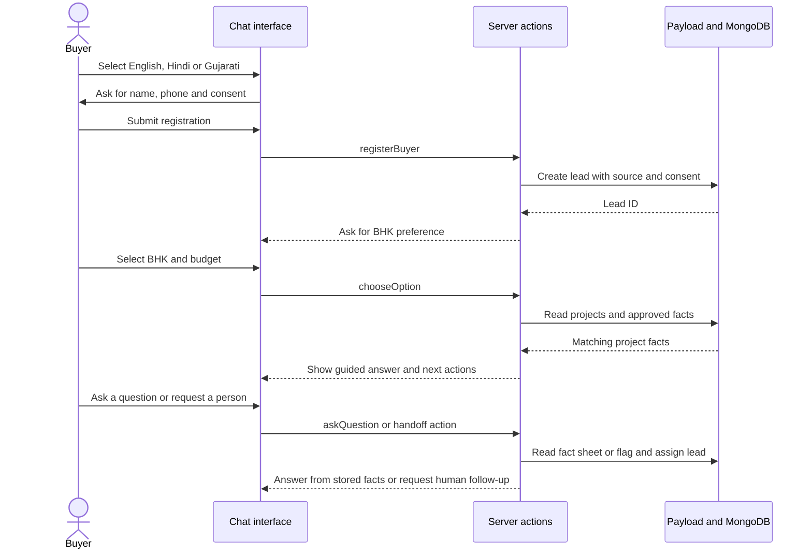
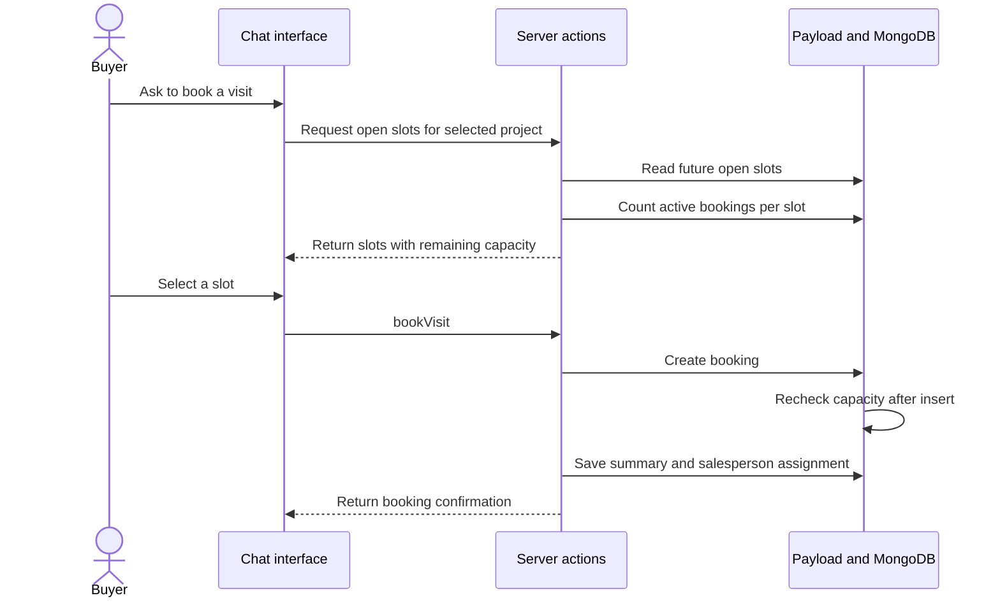

<p align="center">
  
</p>

<h1 align="center">🏡 HOMIQ</h1>

<p align="center">
  <strong>A more thoughtful first step towards finding a home.</strong><br/>
  Residential discovery · Multilingual conversations · Lead management · Site visits
</p>

<p align="center">
  <a href="https://isocode-homiq.vercel.app/"></a>
  <a href="https://github.com/MadhuTiwari-345/IsoCode"></a>
</p>

<p align="center">
  
  
  
  
  
  
</p>

---

<p align="center"><em>Thoughtful homes deserve thoughtful conversations.</em></p>

## 🏡 About HOMIQ

HOMIQ is a residential discovery and lead-management application for a developer with two live residential projects in Ahmedabad. It is designed to connect the buyer journey with the sales team's daily workflow, from the first enquiry to a site visit.

The client brief describes 420 apartments across 2 BHK and 3 BHK configurations, with an indicative portfolio range of ₹65 lakh to ₹1.2 crore. The brief also describes 3,000 monthly leads and ₹30 lakh in monthly marketing and portal spend. Those figures are client-provided planning assumptions, not live production analytics.

### What the client needs to improve

- Reduce the time between a buyer enquiry and the first useful response.
- Keep leads from portals, social ads, the website and hoarding calls in one inbox.
- Capture buyer needs, language, source and consent.
- Offer real visit availability and prevent overbooking.
- Give a named salesperson the buyer's context and conversation history.
- Measure response time, visit conversion, attendance and source-level cost.

### Current implementation status

This status is based on a review of the repository's `main` branch. A screen rendering successfully is not proof that its complete workflow has been tested in production.

| Requirement | Current implementation | Assessment |
| --- | --- | --- |
| Public residential discovery | Home, project list and project detail pages | Implemented with launch placeholders when project records are absent |
| Unified lead records | Payload Leads collection with source, stage, contact and ownership fields | Implemented for records created through the application; external portal and hoarding ingestion is not connected |
| Duplicate checks | Normalized phone and email lookup on lead creation | Basic check implemented; concurrent duplicate submissions need stronger protection |
| English, Hindi and Gujarati chat | Language selection and translated prompts | Implemented as guided chat |
| Answers from an approved fact sheet | Topic detection and lookup in Payload Fact Sheet | Basic deterministic lookup, not a connected generative AI agent |
| Budget and needs capture | BHK and budget choices update the lead | Implemented as a guided flow |
| Human handoff | Executive selection, lead summary and chat transcript | Partial; unanswered questions are flagged, but automatic assignment and notification need completion |
| Real free visit slots | Slot list checks current bookings and capacity | Partial; the current post-create capacity check is not atomic under concurrent requests |
| Location pin | Visit confirmation page reads project coordinates | Depends on verified project address and coordinates being entered |
| Reminders at 1 day and 2 hours | Reminder timestamps are stored on booking records | Not delivered; a scheduler and messaging provider are still required |
| Sales dashboard | Response, visit, show-up and source cost calculations | UI exists; current response-time data is unreliable because buyer registration sets it to zero |
| Admin fact sheet and slot editor | Payload collections are available in the admin | Collection-level editing exists; a tailored sales-facing editor and full workflow need validation |
| Sample client records | No occurrences of the three supplied lead IDs were found in the repository source | Seed data still needs to be added and verified |
| WhatsApp | Consent field exists | No live WhatsApp Business integration |

**Important distinction:** the current chat is a deterministic guided assistant. It detects supported topics and retrieves approved fact-sheet entries. The repository does not currently contain a configured LLM provider or a tool-calling AI agent. This is safer than inventing answers, but it does not yet satisfy the full AI-agent requirement as written.

The project catalogue includes clearly labelled launch placeholders for Project 01 and Project 02. They are not verified project identities. Real project names, addresses, map coordinates, RERA registration numbers, inventory and project-specific prices must be supplied by the client before public launch. Do not replace these placeholders with invented claims.

## 🎨 Visual identity

HOMIQ uses a calm, editorial visual direction inspired by residential spaces. The interface pairs warm neutral surfaces with a deep green primary colour, restrained brass accents and clear typography.

| Design token | Hex value | Role |
| --- | --- | --- |
| Warm ivory | `#F7F7F4` | Main background |
| Deep forest | `#234F43` | Primary actions and emphasis |
| Charcoal | `#1B2927` | Main text and structure |
| Muted brass | `#A27B45` | Secondary accents |
| White | `#FFFFFF` | Cards and raised surfaces |

The design prioritizes readable hierarchy, generous spacing, responsive layouts and accessible interactive states.

## 🧰 Technology

| Layer | Technology | Responsibility |
| --- | --- | --- |
| Web framework | Next.js 16 | Application routing and rendering |
| UI | React 19 | Interactive interface |
| Language | TypeScript | Typed application code |
| Content and admin | Payload CMS 4 | Collections and administration |
| Database | MongoDB | Persistent application data |
| Database adapter | Payload Mongoose adapter | Payload database connection |
| Styling | Tailwind CSS 4 | Responsive styling |
| Hosting | Vercel | Web deployment |

## 🏗️ Architecture

HOMIQ is currently a Next.js application with Payload CMS as its application data layer and MongoDB as its database. The buyer interface and staff workspace use the same application and data model.

### System architecture



### Main application layers

| Layer | Responsibility | Main code locations |
| --- | --- | --- |
| Presentation | Public pages, buyer chat, visit confirmation and staff screens | `src/app/(frontend)`, `src/components` |
| Buyer workflow | Language selection, registration, qualification, fact lookup, handoff and booking actions | `src/app/(frontend)/chat/actions.ts` |
| Authentication | Buyer and staff application sessions | `src/lib/app-auth.ts`, `src/collections/Users.ts` |
| Business data | Leads, projects, facts, staff, slots, bookings and spend | `src/collections` |
| CMS and access | Payload configuration, collection permissions and admin interface | `src/payload.config.ts`, `src/collections` |
| Persistence | MongoDB through Payload's Mongoose adapter | `src/payload.config.ts` |
| Hosting | Next.js deployment and environment configuration | Vercel |

### Buyer chat sequence



This sequence describes the current guided implementation. It does not represent a live LLM tool call. Unknown topics are flagged for review rather than answered from general model knowledge.

### Site visit booking sequence



**Booking reliability warning:** the current capacity guard runs after a booking is inserted. Two simultaneous requests can both observe spare capacity before either post-insert check completes. This is not an atomic reservation. Do not describe the current implementation as guaranteeing zero double bookings until slot allocation is moved to an atomic database operation or a serialized reservation mechanism and concurrency tests pass.

### Data flow at a glance

1. A buyer enters through the website and selects a chat language.
2. The buyer submits contact information and DPDP consent.
3. The server creates a lead and records the source tag.
4. The guided chat collects configuration and budget preferences.
5. The assistant retrieves supported answers from the selected project's fact sheet.
6. A buyer can request a human at any time. The lead can be assigned to a sales executive and flagged for review.
7. The booking flow lists future slots and creates a booking record.
8. The visit confirmation page displays the booking, project map and stored reminder times.
9. Sales users review leads, chat history, bookings and source metrics in the staff workspace.

## 🗃️ Data model

The Payload configuration registers collections for the main application concepts:

- **Projects:** Residential project records.
- **Fact Sheet:** Sales-managed facts used to support buyer conversations.
- **Leads:** Buyer contact details, source, preferences, consent, stage and ownership.
- **Chat Messages:** Conversation history.
- **Sales Executives:** Sales-team records and assignment context.
- **Visit Slots:** Visit availability.
- **Bookings:** Scheduled visit records and reminder timestamps.
- **Source Spend:** Marketing spend inputs for source-level reporting.
- **Users and Admins:** Application users and administrative access.
- **Media, Folders and Tags:** Content organization.

## 🧩 Screen map and wireframes

The experience is organized around two entry points: a buyer-facing website and a protected sales workspace. The wireframes below are structural sketches, not pixel-perfect screenshots.

### Buyer-facing journey

| Screen | Purpose |
| --- | --- |
| Home | Introduce the residential offering and start a conversation |
| Residences | Browse the two project records |
| Project overview | Review approved project facts and continue to chat |
| Concierge chat | Select language, register, share needs, ask questions and book |
| Visit confirmation | Review date, time, location pin, advisor and reminder schedule |

### Sales workspace

| Screen | Purpose |
| --- | --- |
| Sales overview | Review response, visit, attendance and source performance |
| Lead inbox | Filter leads by source, duplicate status and review flag |
| Lead detail | Review buyer profile, duplicate links, handoff summary and chat history |
| Site visits | Review bookings and mark attendance, no-show or cancellation |

The Payload admin provides collection editors for project records, the fact sheet, visit slots, sales executives and source spend. These editors are part of the CMS administration layer rather than a separate custom sales screen.

### Wireframe: buyer discovery

```text
┌──────────────────────────────────────────────────────────────┐
│ HOMIQ                                      Residences  FAQs   │
├──────────────────────────────────────────────────────────────┤
│                                                              │
│  Ahmedabad · 2 and 3 BHK residences                          │
│                                                              │
│  Homes made for the way you live.                             │
│  Ask a question in the language you think in.                 │
│                                                              │
│  [ English ] [ हिन्दी ] [ ગુજરાતી ] [ Book a visit ]          │
│                                                              │
├──────────────────────────────────────────────────────────────┤
│  Current projects                                             │
│  ┌────────────────────────┐  ┌────────────────────────┐       │
│  │ Project 01             │  │ Project 02             │       │
│  │ Verified image/details │  │ Verified image/details │       │
│  │ Explore overview       │  │ Explore overview       │       │
│  └────────────────────────┘  └────────────────────────┘       │
└──────────────────────────────────────────────────────────────┘
```

### Wireframe: guided chat and booking

```text
┌──────────────────────────────────────────────────────────────┐
│ HOMIQ concierge                    Verified project facts     │
├──────────────────────────────────────────────────────────────┤
│                                                              │
│  HOMIQ: Welcome. Which language would you prefer?             │
│  [ English ] [ हिन्दी ] [ ગુજરાતી ]                            │
│                                                              │
│  HOMIQ: First, tell us your name and phone number.             │
│  [ Name __________________________________ ]                  │
│  [ Phone _________________________________ ]                  │
│  [ ] I agree to be contacted about this enquiry               │
│  [ ] I opt in to WhatsApp updates                             │
│  [ Continue ]                                                  │
│                                                              │
│  HOMIQ: Are you looking for a 2 BHK or 3 BHK?                 │
│  [ 2 BHK ] [ 3 BHK ]                                          │
│                                                              │
│  HOMIQ: What budget range should we consider?                 │
│  [ Range A ] [ Range B ] [ Range C ]                           │
│                                                              │
│  Available visit times                                         │
│  [ Slot 1 ] [ Slot 2 ] [ Slot 3 ]                              │
│                                                              │
│  [ Type a question __________________________ ] [ Send ]      │
│  Talk to a person                                              │
└──────────────────────────────────────────────────────────────┘
```

### Wireframe: sales workspace

```text
┌──────────────────────────────────────────────────────────────┐
│ HOMIQ Sales                         Overview  Leads  Visits   │
├───────────────┬──────────────────────────────────────────────┤
│ Navigation    │ Lead performance                              │
│               │                                                │
│ Overview      │ [Response time] [Unreached] [Visit rate]       │
│ Lead inbox    │ [Show-up rate] [Cost per visit]                │
│ Site visits   │                                                │
│ Fact sheet    │ Source performance                             │
│ Visit slots   │ ┌──────────────────────────────────────────┐   │
│               │ │ Source | Leads | Visits | Spend | Cost  │   │
│               │ └──────────────────────────────────────────┘   │
│               │                                                │
│               │ Flagged chats       Waiting for first contact  │
└───────────────┴──────────────────────────────────────────────┘
```

### Wireframe: lead detail and human handoff

```text
┌──────────────────────────────────────────────────────────────┐
│ Lead LD-XXXXX                         Assigned to [Executive]  │
│ Buyer name                                                     │
├───────────────────────────────┬──────────────────────────────┤
│ Buyer details                 │ Conversation history          │
│ Source and project            │                                │
│ BHK and budget                │ Buyer: ...                     │
│ Consent and response time     │ HOMIQ: ...                     │
│                               │ Buyer: ...                     │
│ Handoff summary               │ HOMIQ: ...                     │
│ Visit booking                 │                                │
└───────────────────────────────┴──────────────────────────────┘
```

## 🚀 Getting started

### Requirements

- Node.js **24.22.1 or newer**, as specified by the project package configuration
- pnpm 9, 10 or 11
- A reachable MongoDB database
- A Payload secret

### 1. Clone the repository

```bash
git clone https://github.com/MadhuTiwari-345/IsoCode.git
cd IsoCode
```

### 2. Install dependencies

```bash
corepack enable
pnpm install
```

### 3. Configure environment variables

Create a `.env` file in the repository root:

```env
DATABASE_URL=mongodb+srv://<username>:<password>@<cluster>/<database>
PAYLOAD_SECRET=<long-random-secret>
NEXT_PUBLIC_SITE_URL=http://localhost:3000
```

Use your own MongoDB connection string and a securely generated secret. Do not commit real credentials.

### 4. Generate Payload files

```bash
pnpm generate:importmap
pnpm generate:types
```

### 5. Start the development server

```bash
pnpm dev
```

Open [http://localhost:3000](http://localhost:3000).

The Payload admin interface is available at [http://localhost:3000/admin](http://localhost:3000/admin).

## 📜 Available scripts

| Command | Purpose |
| --- | --- |
| `pnpm dev` | Start the Next.js development server |
| `pnpm build` | Build the Payload and Next.js application |
| `pnpm start` | Start the production server |
| `pnpm generate:importmap` | Generate the Payload import map |
| `pnpm generate:types` | Generate Payload TypeScript types |
| `pnpm payload` | Run the Payload CLI |
| `pnpm db:migrate` | Run Payload database migrations |
| `pnpm db:migrate:create` | Create a database migration |
| `pnpm format` | Format supported files with oxfmt |

## ☁️ Deployment

HOMIQ is deployed on Vercel.

1. Import this GitHub repository into Vercel.
2. Set the project root to the repository root.
3. Select Node.js 24.x.
4. Add the required environment variables:
   - `DATABASE_URL`
   - `PAYLOAD_SECRET`
   - `NEXT_PUBLIC_SITE_URL`
5. Confirm that the MongoDB database accepts connections from the deployment environment.
6. Deploy and verify the public pages, buyer conversation flow and protected staff routes.

Keep production credentials in Vercel environment settings. Never add secrets to source control.

## 🔐 Privacy and AI safeguards

- Collect buyer consent before storing contact information for follow-up.
- Respect communication opt-outs.
- Enable WhatsApp communication only after the required opt-in and approved template setup.
- Use verified project facts for buyer-facing answers.
- Escalate unanswered questions to a human sales representative.
- Do not invent project details, RERA identifiers, inventory, final prices or discounts.
- Restrict access to buyer information according to each user's role.

These are product requirements and operating safeguards. Their presence in this README should not be interpreted as a legal compliance certification.

## 📦 Project scope

### In scope

- Residential discovery experience
- Lead capture and source context
- Guided multilingual conversation
- Sales-managed project facts
- Lead management and handoff concepts
- Visit-slot and booking workflows
- Sales operations workspace

### Outside the current scope

- Full enterprise CRM replacement
- Payment collection
- Apartment allotment and legal documentation
- Automated outbound voice calling
- Live WhatsApp Business messaging integration

Reminder timestamps are data only until a delivery provider and scheduled execution process are configured.

## 🛣️ Next steps

- [ ] Verify buyer registration and lead creation end to end in production
- [ ] Add verified project content, imagery, addresses and RERA details
- [ ] Test duplicate detection against concurrent submissions
- [ ] Verify visit-slot capacity under simultaneous booking attempts
- [ ] Configure and test reminder delivery
- [ ] Connect an approved WhatsApp Business provider after opt-in and template review
- [ ] Validate dashboard calculations against real operational data
- [ ] Add automated tests for the critical buyer and staff workflows

## 🤝 Contributing

1. Fork the repository.
2. Create a focused branch: `git checkout -b feature/your-change`.
3. Make and test your changes.
4. Commit with a clear message.
5. Push your branch and open a pull request.

Please describe user-visible changes and include reproduction steps when reporting a bug.

## 🔗 Links

- **Live application:** [isocode-homiq.vercel.app](https://isocode-homiq.vercel.app/)
- **Repository:** [MadhuTiwari-345/IsoCode](https://github.com/MadhuTiwari-345/IsoCode)

---

<p align="center">
  <strong>HOMIQ</strong><br/>
  <sub>A thoughtful first conversation can make all the difference.</sub>
</p>
