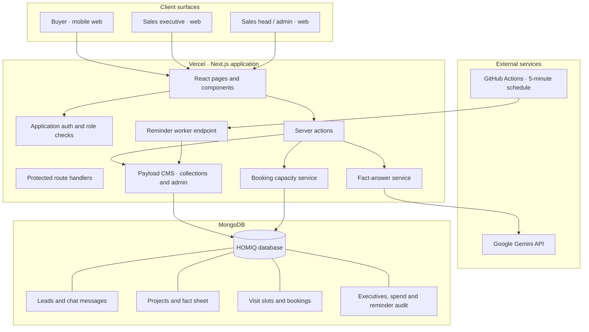
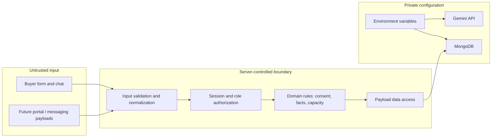
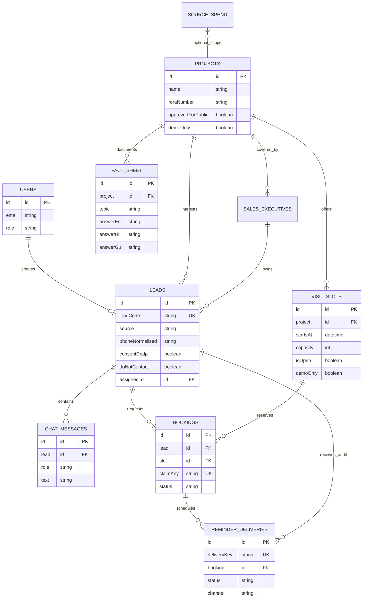
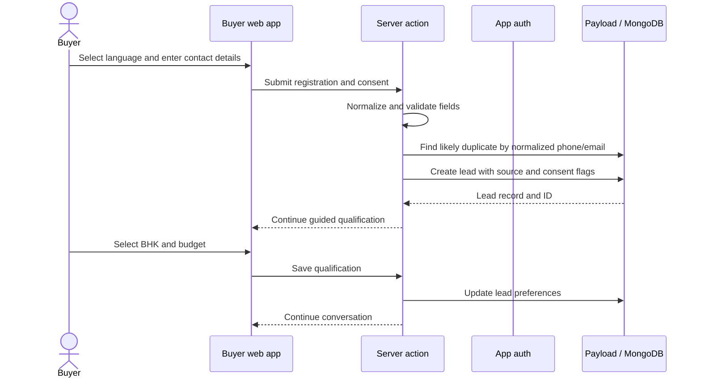
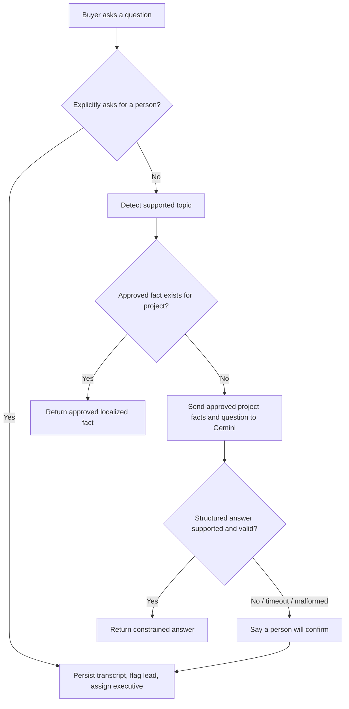
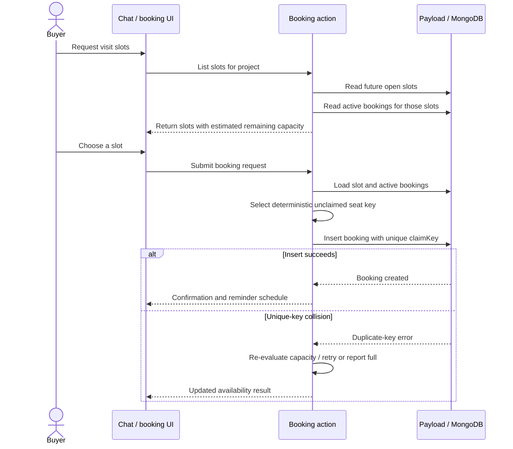
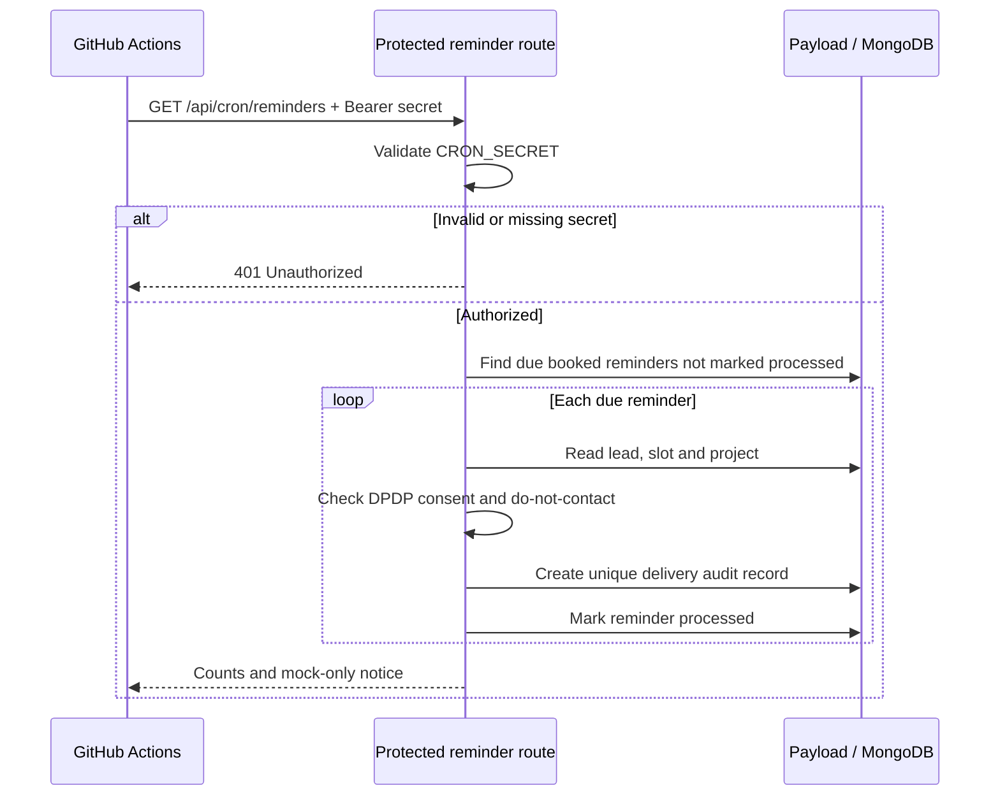

# HOMIQ | Technical Design Document

**Repository:** https://github.com/MadhuTiwari-345/IsoCode  
**Live application:** https://isocode-homiq.vercel.app  
**Document status:** Engineering design and implementation record  
**Prepared:** 9 November 2026

> **Evidence convention:** “Implemented” means the behavior is present in the repository. “Verified” means a recorded automated or operational check has run. “Pending” means it still requires an integration, staging or client-side validation. The distinction matters: a successful build is not proof of a complete user journey.

---

## 1. Product summary

HOMIQ connects a residential buyer's first enquiry to qualification, approved project information, a site-visit request and a human sales handoff. It provides a buyer-facing web experience and a protected sales workspace.

The client brief describes Company A as an Ahmedabad developer with two projects, 420 apartments, 2/3 BHK configurations and a combined indicative portfolio price range of ₹65 lakh–₹1.2 crore. The brief also supplies planning assumptions of 3,000 leads/month, ₹30 lakh monthly marketing spend, ₹1,000 cost per lead, a 14-hour median first response, 35% unreached within 48 hours and 6% lead-to-visit conversion. These are **brief-supplied assumptions**, not measured HOMIQ production results.

### Product objectives

- Capture enquiries with source attribution and identify likely duplicates.
- Respond in English, Hindi or Gujarati using approved facts.
- Collect buyer configuration and budget preferences.
- Offer only future, open visit slots and protect seat claims against duplicate allocation.
- Preserve the conversation and assign serious or unsupported enquiries to sales.
- Give sales users visibility into response, visits, attendance and source performance.

### Success measures from the brief

| Measure | Starting point in brief | Target in brief |
|---|---:|---:|
| Median first response | 14 hours | Under 5 minutes |
| Leads unreached within 48 hours | 35% | Under 5% |
| Lead-to-site-visit conversion | 6% | 8% within 3 months |

Targets are acceptance goals for a future operating rollout. The prototype does not claim to have achieved them.

---

## 2. Scope and boundaries

### Included in the core slice

1. Buyer registration, consent and language selection.
2. Source-tagged lead creation and duplicate indication.
3. Guided qualification for 2/3 BHK and budget.
4. Fact-sheet answers with constrained Gemini fallback and escalation.
5. Future visit-slot discovery and booking with a unique seat-claim key.
6. Transcript persistence, handoff summary and executive assignment.
7. Sales lead inbox, lead detail, visit outcome management and source dashboard.
8. Admin-managed project facts, visit slots, sales roster and source spend.
9. Protected reminder processing with mock delivery audit records.

### Explicitly out of scope

- Full CRM replacement.
- Payments, apartment allotment and legal documents.
- Outbound voice calling.
- Live portal integrations and live WhatsApp Business messaging.
- A real client calendar or external messaging provider.

The product is a focused workflow, not a claim that all 60 staff operations or every external lead source have been integrated.

---

## 3. System architecture

### 3.1 Architecture at a glance

HOMIQ uses a modular monolith: one Next.js application contains the buyer UI, staff UI, server actions, API routes and Payload CMS data layer. MongoDB is the persistent store. This keeps deployment and operational overhead low for a small product team while retaining clear domain boundaries.

### 3.2 Runtime responsibilities

| Component | Responsibility | Code location |
|---|---|---|
| Buyer presentation | Discovery, chat, consent, qualification and visit confirmation | `src/app/(frontend)`, `src/components` |
| Staff presentation | Overview, lead inbox, lead detail and visit outcomes | `src/app/(frontend)/staff` |
| Application authentication | Buyer/staff session and role helpers | `src/lib/app-auth.ts`, `src/collections/Users.ts` |
| Conversation orchestration | Guided chat, fact lookup, Gemini fallback, logging and handoff | `src/app/(frontend)/chat/actions.ts` |
| CMS and access control | Collection schemas, admin interface and collection access | `src/payload.config.ts`, `src/collections` |
| Booking domain | Slot validation, seat allocation and booking lifecycle | `src/collections/Bookings.ts`, `src/lib/booking-capacity.ts` |
| Reminder processing | Authentication, due-job lookup, consent gate and idempotency record | `src/app/api/cron/reminders/route.ts` |
| Persistence | Payload Mongoose adapter over MongoDB | `src/payload.config.ts` |
| Hosting and scheduler | Vercel deployment and GitHub Actions schedule | Vercel project, `.github/workflows/homiq-reminders.yml` |

### 3.3 Why this architecture

- **One deployable unit:** avoids coordinating a separate API service and frontend for a deliberately narrow scope.
- **Server-side business rules:** client UI does not decide whether a slot is bookable or whether an answer is supported.
- **Payload collections:** give structured data, relationships, admin editing and access policies without building a separate CMS.
- **MongoDB:** aligns with Payload's Mongo adapter and stores conversation, lead and booking records together.
- **External scheduler:** the reminder endpoint can be called independently of a long-running web process. GitHub Actions currently polls it every five minutes.
- **Replaceable integrations:** Gemini and mock reminder delivery are behind server-side boundaries, so providers can be changed without rewriting the buyer journey.

### 3.4 Trust boundaries

All secrets stay server-side. Buyer input is untrusted, normalized and validated before domain actions. Public signup must not be able to grant staff roles. Administrative operations require staff authorization and role checks.

---

## 4. Data architecture

### 4.1 Collection model

The diagram shows logical relationships; Payload relationship fields may be stored as IDs or populated relationship objects at runtime.

### 4.2 Collection responsibilities

| Collection | Key fields and purpose |
|---|---|
| `users` / `admins` | Authenticated buyer and staff identities; admin access is separate. |
| `projects` | Project label, locality, address, map coordinates, RERA number, portfolio facts, public approval and demo flags. |
| `fact-sheet` | Sales-approved project facts with English, Hindi and Gujarati answer fields. |
| `leads` | Contact, source, language, preferences, consent, opt-out, duplicate link, stage, response time, assignee and handoff summary. |
| `chat-messages` | Persisted buyer and assistant transcript turns. |
| `sales-executives` | Active state, language coverage, project coverage and assignment details. |
| `visit-slots` | Project, start time, duration, capacity, open state and demo-only marker. |
| `bookings` | Lead/slot relationship, status, unique seat claim and reminder timestamps. |
| `reminder-deliveries` | Idempotency key, reminder kind, mock channel, outcome and audit text. |
| `source-spend` | Source-level spend inputs used for cost reporting. |

### 4.3 Indexing and data integrity

- Lead code, booking code, booking `claimKey` and reminder `deliveryKey` are declared unique in Payload field definitions.
- Lead phone normalization and source/stage/ownership fields are indexed for common lookup and filtering.
- Booking seat claims use a deterministic slot-plus-seat key. The booking hook reads current active bookings, chooses a free seat key, then relies on the unique index as the final insert-time race guard.
- Reminder delivery keys use booking ID plus reminder kind to make repeated worker invocations idempotent.
- Duplicate lead detection is a normalized phone/email lookup before insert. **It is not a database-level uniqueness guarantee**, so two simultaneous lead submissions can still race and require a future unique-key or transactional design if strict deduplication is required.

**Concurrency caveat:** the schema declares `claimKey` unique, but the live MongoDB index's deployed options and a simultaneous booking race have not yet been verified against a disposable staging database. Do not describe no-double-booking as integration-tested until that test passes.

---

## 5. Core workflows

### 5.1 Buyer registration and lead capture

Consent to process an enquiry and WhatsApp opt-in are separate fields. No WhatsApp message should be sent merely because DPDP consent is true. The source value is captured from the supported source set; external portal ingestion is not currently connected.

### 5.2 AI answer and safe fallback

**Implemented behavior**

1. Deterministic topic detection and fact-sheet lookup take priority.
2. If no deterministic answer exists, the server may call Gemini with the selected project's approved fact-sheet entries and the buyer's question.
3. Gemini is instructed to return a structured supported/unsupported result and must not add unsupported claims.
4. Unsupported, malformed, failed or uncertain responses fall back to a human-confirmation message and handoff.
5. The transcript is persisted before handoff summary and assignment are completed.
6. The buyer may request a human at any time.

**Important implementation distinction:** this is a guided conversational workflow with a constrained Gemini answer fallback. The booking action is a separate validated server action, not an LLM function-calling tool. The product should be presented as an AI-assisted workflow with a booking capability, not as an autonomous agent that independently invokes tools.

**Hard prohibitions**

- Never invent amenities, possession dates, location, approvals, RERA registration, inventory or availability.
- Never quote a final price or discount.
- The combined portfolio price range is not a project-specific offer.
- If the approved fact sheet lacks an answer, a human must confirm it.

### 5.3 Booking and capacity protection

The UI's remaining-capacity display is advisory. The server rechecks slot state and active bookings when creating the booking. A unique `claimKey` is intended to be the final guard against two requests claiming the same seat. Cancelled/no-show bookings release their claim by changing the key to a unique tombstone.

**Operational limits:** demo slots are simulated because no real client calendar was supplied. Existing historical sample bookings are historical records, not available slots. A staging concurrency test and live unique-index inspection remain pending.

### 5.4 Human handoff and assignment

1. Buyer requests a person, or the assistant cannot safely answer.
2. The current buyer message and assistant turn are persisted.
3. The lead is flagged with a reason and a concise handoff summary.
4. The assignment helper selects an active executive, preferring project/language fit and then the least-loaded candidate.
5. The staff workspace exposes the lead, transcript, summary and owner for follow-up.
6. Sales head reviews flagged chats.

No real SMS, email, push or WhatsApp staff notification is connected. Assignment in the application is not equivalent to a delivered notification.

### 5.5 Reminder lifecycle

The worker handles two due times: 24 hours and two hours before the visit. It checks `consentDpdp` and `doNotContact`, writes an idempotent `reminder-deliveries` audit record, and updates the booking's sent timestamp. The channel is **mock**: a “sent” result means simulated processing, not an SMS or WhatsApp delivery.

GitHub Actions invokes the protected endpoint every five minutes and supports manual dispatch. The endpoint has been invoked successfully; the recorded successful invocation processed zero due reminders. This verifies authentication and route execution for that run, not end-to-end delivery for a due reminder.

---

## 6. UX and interaction design

### 6.1 Visual direction

- Warm ivory backgrounds and generous whitespace establish a calm residential tone.
- Deep forest green is reserved for primary actions and key navigation.
- Charcoal text provides contrast; restrained brass accents are used sparingly.
- Typography and spacing prioritize legibility over dense CRM-style tables.
- Buyer journeys are mobile-first; staff tools prioritize scanability and clear ownership.

### 6.2 Screen architecture

| Screen | Primary user | Main job |
|---|---|---|
| Home / discovery | Buyer | Understand the offering and start an enquiry. |
| Project overview | Buyer | Read only approved public project details. |
| Concierge chat | Buyer | Choose language, consent, share needs, ask questions and request a person. |
| Visit selection / confirmation | Buyer | Choose a future slot and review booking details. |
| Sales overview | Executive / head | Monitor response, visits, attendance and source metrics. |
| Lead inbox | Executive / head | Find and prioritize leads by source, stage, duplicate and flag. |
| Lead detail | Executive / head | Review preferences, transcript, summary and assignment. |
| Visit management | Executive / head | Review bookings and record attended/no-show/cancelled outcomes. |
| Admin collections | Sales head / admin | Maintain approved project facts, sales roster, visit slots and spend. |

### 6.3 Interaction principles

- Keep chat prompts short and use selectable choices for common answers.
- Show consent separately from optional WhatsApp opt-in.
- Explain unsupported answers plainly and provide a human path.
- Do not show a slot as available unless it is future-dated and open at query time.
- Label simulated slots and demo project content.
- Provide loading, empty and error feedback rather than inert controls.
- Preserve a clear return path between the buyer conversation and booking confirmation.

---

## 7. Security, privacy and compliance design

| Concern | Control in the application | Remaining responsibility |
|---|---|---|
| Authentication | Payload users/admins and application session helpers | Provision and test each reviewer role. |
| Authorization | Collection access rules and server-side role checks | Execute role-by-role access tests. |
| Input handling | Server-side normalization and validation in chat actions | Add automated abuse/rate-limit coverage before public scale. |
| Secrets | Server environment variables; no API key committed | Rotate credentials if exposed and redeploy after changing production env. |
| Buyer consent | `consentDpdp`, timestamp and separate `whatsappOptIn` | Client must approve notices, retention and legal basis. |
| Opt-out | `doNotContact` and `optedOutAt`; reminder worker checks flag | Apply the same check to any future outbound provider. |
| RERA | Project public approval defaults false; project facts are not invented | Client/legal team must validate registration and all promotional claims. |
| AI safety | Approved fact context, constrained response format and human fallback | Evaluate adversarial prompts and localized answers before release. |
| Booking integrity | Server capacity check and unique claim key | Verify deployed index and concurrent behavior in staging. |
| Reminder audit | Unique delivery key and explicit mock channel | Provider callbacks and delivery receipts are not implemented. |

This document describes engineering controls, not legal certification under the DPDP Act or RERA. Company A and its legal/compliance advisors must approve public content and communication practices.

---

## 8. Deployment and operations

### 8.1 Production topology

- **Application:** Vercel project `isocode-homiq`, deployed from `main`.
- **Database:** MongoDB Atlas through Payload's Mongoose adapter.
- **AI provider:** Gemini API, called server-side.
- **Scheduled worker:** GitHub Actions workflow `.github/workflows/homiq-reminders.yml`.
- **Protected endpoint:** `GET /api/cron/reminders`, requires `Authorization: Bearer <CRON_SECRET>`.

### 8.2 Environment variable names

| Variable | Purpose |
|---|---|
| `DATABASE_URL` | MongoDB connection string. |
| `PAYLOAD_SECRET` | Payload signing/encryption secret. |
| `GEMINI_API_KEY` | Server-side Gemini credential. |
| `NEXT_PUBLIC_SITE_URL` | Canonical application URL. |
| `CRON_SECRET` | Protects the reminder endpoint. |

GitHub Actions repository secrets:

- `HOMIQ_BASE_URL`: production or staging base URL.
- `CRON_SECRET`: same secret configured for the target deployment.

Never place secret values in this document, README, source control or screenshots.

### 8.3 Local development

See [deployment.md](../deployment.md) for exact prerequisites, install commands, environment setup, reviewer provisioning and run steps.

---

## 9. Verification record

This table intentionally separates CI/build evidence from complete workflow verification.

| Area | Current evidence | Status |
|---|---|---|
| Production build | Vercel production deployment reports READY for the recorded production commit. | Verified build/deployment |
| Unit tests and type generation | Latest recorded CI run completed unit tests, Payload type generation and TypeScript validation. | Verified in CI |
| Reminder endpoint auth | Protected endpoint invocation succeeded; zero due reminders processed in that run. | Endpoint execution verified |
| Scheduled reminder delivery | Mock-only records; no external provider. | Partial / simulated |
| Buyer, executive and sales-head authenticated journeys | No complete authenticated browser E2E run recorded. | Pending |
| Multilingual supported/unsupported AI scenarios | Implemented in the chat flow; full role-based production E2E evidence not recorded. | Pending E2E |
| Booking race behavior | Unique claim key declared in schema; live index options and concurrent staging test not confirmed. | Pending integration test |
| Dashboard reconciliation | UI and calculations exist; no verified client spend/attendance dataset. | Pending data validation |
| RERA, location and inventory | Client-approved values were not supplied. | External dependency |
| WhatsApp/SMS | No provider configured. | Out of scope for current prototype |

**Do not treat a green CI run or READY deployment as proof that every buyer-to-sales workflow has passed.**

---

## 10. Assumptions, constraints and decisions

| ID | Assumption / missing input | Design decision |
|---|---|---|
| A1 | The 420 apartments and ₹65 lakh–₹1.2 crore range describe the combined portfolio. | Never use these as a project-specific final quote. |
| A2 | “Project 1” and “Project 2” are anonymized labels. | Retain generic demo labels. |
| A3 | Project-specific RERA IDs, addresses and map coordinates are absent. | Do not invent them; keep public approval disabled until verified. |
| A4 | No actual visit calendar was provided. | Use clearly labelled demo slots only. |
| A5 | No real sales roster or contact details were provided. | Use demo records only; do not impersonate client staff. |
| A6 | Lead volume, spend and conversion rates are planning assumptions. | Mark them as baseline assumptions, not measured KPIs. |
| A7 | Three sample leads are in the written brief. An additional 18-row PDF dataset has been referenced separately. | Current seed scope is the three written sample rows unless the additional file is reconciled. |
| A8 | Messaging can be mocked for the prototype. | Reminder worker records simulated outcomes only. |
| A9 | Reviewer identities were not provided in the brief. | Provision accounts using private environment variables; never commit default passwords. |
| A10 | The brief asks for an AI assistant with a booking tool. | Current implementation keeps booking as a server-side domain action rather than LLM function calling; this is a conscious safety and scope decision. |

### Important engineering trade-offs

- **Duplicate detection:** pre-insert lookup is simple and useful for a demo, but not race-proof. A normalized-contact uniqueness strategy needs a product decision about shared family phone numbers and multiple enquiries.
- **Booking:** seat claims are designed to use a unique database key. The production database index must be inspected and concurrency tested before claiming the guarantee is proven operationally.
- **AI:** the model is not trusted to decide availability or write bookings. It can only answer from approved facts; booking remains deterministic.
- **Reminders:** five-minute polling is acceptable for the prototype but is not an exact-time delivery guarantee. A production messaging provider and delivery callbacks are future work.
- **Reporting:** cost-per-visit depends on accurate source spend and attendance outcomes. The dashboard cannot produce trustworthy client ROI until those inputs are maintained.

---

## 11. Delivery plan and next engineering steps

1. Create a disposable staging database and seed only anonymized demo records.
2. Provision buyer, executive and sales-head reviewer accounts through the private provisioning script.
3. Run authenticated browser journeys for registration, consent, duplicate handling, English/Hindi/Gujarati chat, unsupported-question handoff, booking, assignment, attendance and dashboard.
4. Inspect MongoDB indexes and confirm `claimKey` is actually unique in the target database.
5. Run simultaneous booking requests against the same capacity-limited slot and assert that successful bookings never exceed capacity.
6. Create due reminder fixtures for consented, no-consent and opted-out leads; verify idempotency and audit statuses.
7. Reconcile the additional sample dataset, if supplied, before importing it.
8. Obtain approved RERA details, project addresses, map coordinates, fact sheets, sales roster and real visit calendar from Company A.
9. Connect portal ingestion and WhatsApp only after provider, opt-in template, consent and callback design is approved.
10. Reconcile dashboard formulas with the sales head's definitions and verified source-spend records.

---

## 12. Submission references

- **Source repository:** https://github.com/MadhuTiwari-345/IsoCode
- **Live application:** https://isocode-homiq.vercel.app
- **Deployment guide:** [deployment.md](../deployment.md)
- **Operational README:** [README.md](../README.md)

HOMIQ is designed to make the first response useful, the next step clear and the handoff accountable. The product should only move from demo to live sales use after the pending identity, data, booking and messaging checks are completed.
