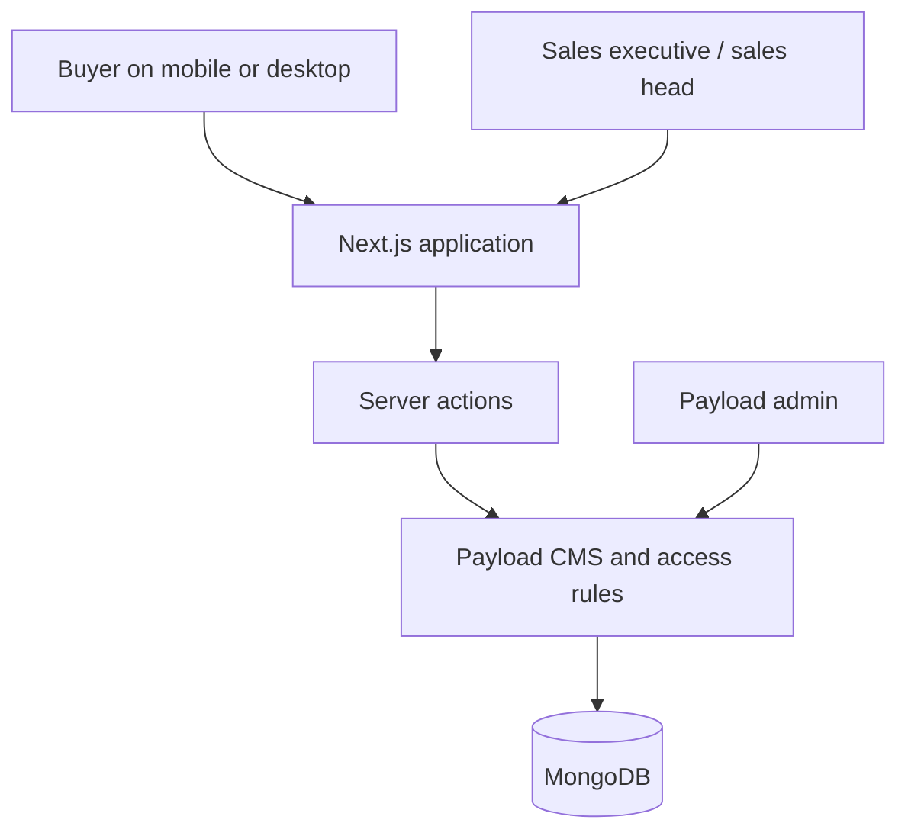

# HOMIQ Technical Design Document

**GitHub:** https://github.com/MadhuTiwari-345/IsoCode  
**Live application:** https://isocode-homiq.vercel.app

## 1. Problem and goals

Company A is a residential developer in Ahmedabad with two live projects, 420 apartments, 2 BHK and 3 BHK configurations, and a stated portfolio price range of ₹65 lakh to ₹1.2 crore. The brief describes enquiries arriving from property portals, social media, the website and a hoarding phone number, currently handled through an inbox, spreadsheet and next-morning telecalling.

The product goal is to respond quickly in the buyer's language, capture requirements, answer only approved project facts, offer a genuinely available site-visit slot and transfer serious or uncertain conversations to a named salesperson with context.

The brief's baseline and target figures are treated as planning assumptions, not measured product analytics:
- 3,000 leads/month and ₹30 lakh monthly spend.
- ₹1,000 cost per lead.
- 14-hour median first response.
- 35% not reached within 48 hours.
- 6% lead-to-visit rate, with an 8% target.
- Under 5 minutes median first response and under 5% unreached within 48 hours.

## 2. Architecture and rationale

The application uses Next.js 16 with React 19 and TypeScript for the buyer-facing site and staff workspace. Payload CMS provides collection modelling, authentication integration, server-side data access and an administrative interface. MongoDB stores application records. Vercel hosts the Next.js application.

This keeps the buyer flow, staff tools and data layer in one deployable application. Payload was selected because the project needs structured, editable business facts and role-aware access without introducing a separate bespoke admin service.

### Architecture

### Main modules

| Module | Responsibility |
| --- | --- |
| Buyer pages and chat | Language choice, consent, lead capture, qualification and booking |
| Staff workspace | Lead list, assignment, flagged conversations and source performance |
| Payload collections | Projects, facts, leads, messages, sales executives, slots, bookings and source spend |
| Authentication | Website accounts with buyer, executive and head roles; separate CMS administrators |
| MongoDB | Persistent application records |
| Vercel | Application hosting and deployment |

## 3. Data model

| Collection | Important fields | Purpose |
| --- | --- | --- |
| Users | email, name, role, executive | Buyer and staff sign-in |
| Projects | name, slug, locality, address, coordinates, RERA, prices, configurations, approvedForPublic | Project catalogue and public approval gate |
| FactSheet | project, topic, English/Hindi/Gujarati answers | Approved source of buyer-facing facts |
| Leads | leadCode, name, phone, normalized phone, source, project, BHK, budget, stage, owner, consent, response timestamps, duplicate marker, handoff summary | Unified lead record |
| ChatMessages | lead, role, text, createdAt | Conversation history |
| SalesExecutives | name, phone, languages, projects, active | Assignment targets |
| VisitSlots | project, startsAt, duration, capacity, isOpen | Visit availability |
| Bookings | lead, slot, project, visitors, status, reminder timestamps | Visit reservations and attendance |
| SourceSpend | source, spendInr, period | Cost-per-lead and cost-per-visit reporting |

The public project approval flag defaults to false. This prevents unverified launch placeholders from being presented as approved project facts. A project must be reviewed against client-provided address, map pin, RERA, pricing, possession and imagery before publication.

## 4. Main flows

### Buyer enquiry

1. Buyer selects English, Hindi or Gujarati.
2. Buyer provides name, Indian mobile number and explicit data-processing consent.
3. The application creates a lead with source and enquiry timestamp.
4. The guided assistant asks for BHK preference and budget.
5. Approved project records and fact-sheet entries are used to respond.
6. The buyer can request a person or ask a question that is not covered by the fact sheet.

### Fact answers and uncertainty

The implemented assistant is deterministic rather than a connected LLM agent. It detects supported topics and retrieves a matching project-specific fact-sheet answer in the selected language. It does not use open-ended model knowledge. When the project or fact is missing, it declines to invent an answer and flags the conversation for human follow-up. Discount and final-price requests are escalated rather than quoted.

This design prioritizes factual control and RERA-safe claims. A constrained LLM with validated tool calling remains a future integration, not a feature claimed as live.

### Site visit

1. The buyer selects a project and requests a visit.
2. The server lists future open slots and estimates remaining capacity from active bookings.
3. The buyer selects a slot.
4. The booking write checks slot state and capacity.
5. A booking code and reminder timestamps are stored.

**Known reliability limitation:** the current collection hook performs a post-insert capacity check. It is not a database-atomic reservation under simultaneous requests and must not be represented as a proven no-double-booking guarantee. The concurrency-safe reservation and simultaneous-request test suite are outstanding.

### Human handoff

The application selects an active executive, marks the lead for review, records the reason and stores a summary with conversation context. Chat turns are now persisted synchronously before the response returns, so a later handoff read does not depend on an after-response callback. Assignment and transcript ordering still require end-to-end concurrency tests.

## 5. UI and design decisions

The interface uses warm ivory surfaces, deep forest-green primary actions, charcoal text and restrained brass accents. It uses generous spacing and clear typographic hierarchy to support a calm, premium residential experience.

Key screens:
- **Project discovery:** lets buyers understand the offering before sharing contact details.
- **Multilingual chat:** uses short prompts and clear choice chips to reduce typing on phones.
- **Visit selection and confirmation:** separates available times from the confirmation state.
- **Buyer account:** gives signed-in buyers continuity for their enquiry and visit.
- **Staff lead workspace:** centralizes source, stage, owner and buyer context.
- **Performance dashboard:** summarizes response, conversion, attendance and source spend.
- **Payload admin:** provides editing for approved project facts, slots and operational records.

The UI should not display invented project names, RERA numbers, addresses or inventory. Public projects remain hidden until approved data is entered.

## 6. Security and privacy

- Secrets are supplied through environment variables, not committed source files.
- Buyer consent is required before lead registration.
- WhatsApp opt-in is represented separately from general data-processing consent.
- Buyer and staff roles are distinct; staff roles cannot be self-selected through public sign-up.
- Collection access rules restrict sensitive lead and message records.
- Server actions validate and normalize key buyer inputs.
- Public project publication requires explicit approval.

A production privacy review, rate limiting, security testing and audit of every server action are still required before real personal data is processed at scale.

## 7. Assumptions and constraints

Every assumption below is based only on the supplied problem statement or is explicitly marked as a product implementation assumption.

1. **[Brief assumption]** The developer has two live projects and the portfolio-wide range is ₹65 lakh to ₹1.2 crore. No project-specific prices are inferred.
2. **[Brief assumption]** The stated lead volume, spend, response time and conversion rates are planning baselines, not database facts.
3. **[Implementation assumption]** The public website is the first lead channel. Property portal feeds and hoarding call ingestion are outside the working web intake until integrations are provided.
4. **[Implementation assumption]** Visit capacity is configured per slot by staff; the brief does not specify party-size rules or slot duration.
5. **[Implementation assumption]** The assistant uses only explicitly stored fact-sheet answers. Missing information is escalated.
6. **[Implementation assumption]** Sample records in a demo environment must use synthetic contact details and must not be mistaken for real buyers.
7. **[Client dependency]** Project names, official addresses, coordinates, RERA identifiers, approved images, possession and unit-level pricing must come from Company A.
8. **[Client dependency]** WhatsApp requires an approved business provider, credentials, templates and opt-in evidence.

## 8. What is cut and what comes next

Out of scope per brief:
- Full CRM replacement.
- Booking payments and allotment letters.
- Outbound voice calling.
- WhatsApp as a live channel in the initial web-chat slice.

Priority next steps:
1. Replace post-insert booking checks with a database-atomic capacity reservation and test simultaneous requests.
2. Add a database-enforced duplicate identity strategy with a safe migration for existing duplicate records.
3. Add automated buyer and staff workflow tests, including access-control and concurrency cases.
4. Add an idempotent scheduled reminder worker with a mock delivery adapter, retries and delivery logs.
5. Add a constrained LLM provider only after its prompts, allowed tools and output validation are tested; retain fact-sheet-only answer rules.
6. Provision synthetic demo data and reviewer accounts in an isolated review database.
7. Validate dashboard metrics against operational definitions and real visit attendance data.
8. Integrate portal feeds and WhatsApp only after client/provider credentials, consent and templates are available.

## 9. Honest implementation status

The repository contains a functioning application structure, buyer registration and guided chat, Payload collections, staff screens, source dashboard and booking flow. However, a visible screen is not proof that the complete flow is production-ready.

Not yet verified as complete:
- Atomic booking reservation under concurrent requests.
- Race-safe duplicate creation.
- Full buyer/staff end-to-end automated tests.
- Scheduled reminder delivery.
- LLM agent and validated booking tool.
- Live WhatsApp.
- Production-ready project facts and RERA content.
- Dashboard accuracy against a representative operational dataset.

The live app should be treated as a review build until these items are completed and tested.
